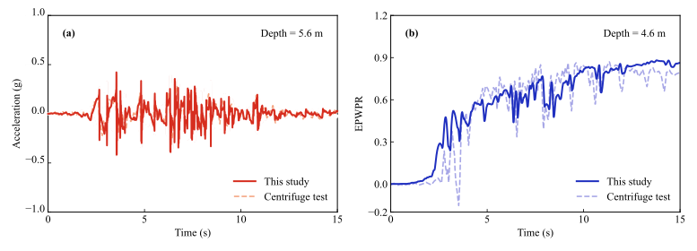
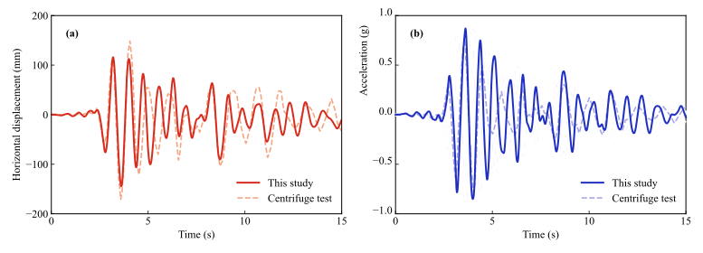
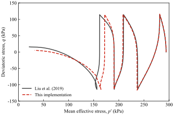
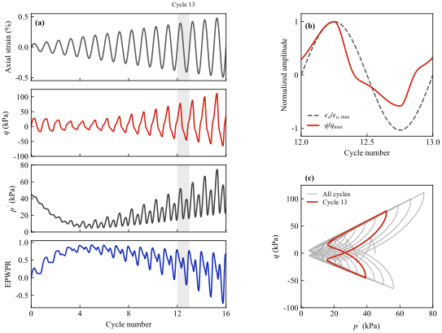

# Stabilized C3D8UW (finite strain) + SANISAND-MS

Abaqus/Standard user element for **saturated porous media in the u–w formulation**, now coupled with the
**SANISAND-MS** bounding-surface sand model (embedded as a UMAT called from inside the UEL).
The repository contains the element, a centrifuge-test validation (Wilson 1998, pile in liquefiable sand)
and two single-element tests of the constitutive model.

> **Related paper:** the formulation and the applications are described in a manuscript currently
> **under review in the *Journal of Geotechnical and Geoenvironmental Engineering* (ASCE, JGGE)**.
> Citation details will be added after acceptance.

> **UMAT source:** the SANISAND-MS material routines are based on the open-source UDSM implementation by
> F. Pisanò and co-workers, [FedericoPisano/SANISAND-MS-UDSM](https://github.com/FedericoPisano/SANISAND-MS-UDSM)
> (GPL-3.0). The constitutive sources are used unchanged; this repository adds an Abaqus UMAT interface
> (stress/strain sign and Voigt-order conversion, state-variable mapping, sub-stepping and tangent) so that the
> model can be called from inside the UEL.

## What is new

| Earlier version | This version |
|---|---|
| UEL only, with a placeholder elastic UMAT | UEL + **SANISAND-MS UMAT** compiled into one file (`UEL_C3D8UW_SANISAND-MS.for`) |
| — | Full 3-D validation against centrifuge test **Csp3, event J** (Wilson 1998) |
| — | Two **single-element tests** of the embedded UMAT (`sanisand_element_test.for`) |

## Repository layout

```
UEL_C3D8UW_SANISAND-MS.for    UEL (u–w, finite strain) + SANISAND-MS UMAT + UVARM / SDVINI / UEXTERNALDB
sanisand_element_test.for     SANISAND-MS + the same UMAT wrapper, with a C-callable entry point (elem_umat)
wilson_csp3_inp/              Abaqus input of the Wilson (1998) Csp3-J model
  wilson_csp3.inp             main file (submit this one)
  mesh_and_sets.inp           nodes, elements, sets, surfaces, contact, input motion
  init_svars_1..6.inp         initial state variables of the soil (K0 geostatic state, 9240 elements)
  cload_geostatic.inp         nodal loads of the geostatic step
images/                       figures used below
```

## 1. The element (UEL)

- 8-node hexahedron, 2×2×2 Gauss points, DOF 1–3 = solid displacement **u**, DOF 4–6 = relative fluid displacement **w**.
- Total-Lagrangian kinematics with Hencky (logarithmic) strain passed to the UMAT; F-bar stabilization of the
  volumetric/Biot terms; Darcy drag and fluid inertia included (dynamic u–w).
- Trial/committed state-variable storage: `NSVARS = 8 × 2 × (13 + 31) = 704` for SANISAND-MS (31 state variables).
- Post-processing: overlay C3D8 "host" elements (label = UEL label + 1 000 000, zero stiffness) receive the
  Gauss-point results through `UVARM` (UVARM1–6 effective stresses, UVARM13 excess pore pressure).

### PROPS (`*UEL PROPERTY`, 36 values)

| # | Meaning |
|---|---|
| 1–7 | `rho_s`, `rho_f`, porosity `n0`, Biot `alpha`, fluid bulk modulus `Qb`, permeability `k`, `gamma_w` |
| 8–32 | 25 SANISAND-MS parameters: G0, ν, Mc, c, λc, e0, ξ, m, h0, ch, nb, A0, nd, **μ0, ζ, β**, TolF, TolR, e_init, e_max, e_min, Mb,c,max, ElScheme, hMexc, hmax |
| 33–36 | wrapper: p_atm (kPa), minimum p′ for the tangent (kPa), max. sub-steps, debug flag |

### Changes to the delivered UEL (marked `[WILSON_VAL]` in the source)

1. A missing `IF (LASTKINC(JELEM) .NE. -999999) THEN` guard line was restored (the file did not compile without it).
2. Trial → committed state is promoted on every call (Abaqus always passes the converged SVARS of the previous increment).
3. `PNEWDT` returned by the UEL keeps the Abaqus value unless the UMAT requests a cut-back
   (the original always returned 1.0, which prevented the time increment from growing again).
4. UMAT wrapper: adaptive sub-stepping (up to 1024 sub-steps). If integration still fails at a single Gauss point,
   that point is updated elastically for that increment and logged as `SSMS-ELASTIC` in the `.msg` file,
   instead of forcing a global cut-back.

## 2. Validation: Wilson (1998) centrifuge test Csp3, event J

Single pile with a superstructure mass in a two-layer Nevada sand profile (Dr ≈ 55 % over Dr ≈ 80 %).

Model settings (`wilson_csp3_inp/`):
- Half model (symmetry plane y = 0): superstructure mass 24.55 Mg, pile-top vertical load 240 kN;
  periodic boundaries on the shaking-direction faces; impermeable boundaries except the ground surface.
- Pile–soil **contact**: separate pile nodes, node-to-surface, rough tangential behaviour, linear (softened)
  normal behaviour 1×10⁶ kPa/m with contact stabilization; pile tip tied to the soil; top 0.6 m of the
  interface excluded.
- Initial stresses imported from a separate geostatic analysis (K0 state, re-imported until residual
  displacements are negligible), followed by a 15 s dynamic step (Δt_max = 0.02 s, Δt_min = 1×10⁻⁷ s).
- SANISAND-MS parameters for Nevada sand; the calibrated memory-surface parameters are **μ0 = 30, ζ = 5×10⁻⁴, β = 1**.

Run (all files of `wilson_csp3_inp/` in one folder, together with the `.for` file):

```bash
abaqus job=wilson_csp3 user=UEL_C3D8UW_SANISAND-MS.for cpus=22 interactive
```

Results compared with the test:





| Quantity | r | nRMSE |
|---|---|---|
| Pore pressure, 4.6 m (free field) | 0.92 | 0.119 |
| Acceleration, 5.6 m (free field) | 0.68 | 0.112 |
| Superstructure displacement (relative to the top ring) | 0.57 | 0.130 |
| Superstructure acceleration | 0.61 | 0.135 |

## 3. Single-element tests of the embedded UMAT

`sanisand_element_test.for` contains exactly the same SANISAND-MS sources and UMAT wrapper as the UEL file, plus a
small entry point `elem_umat` so that the material can be driven point-wise (e.g. compiled as a DLL and called from Python).

**Test 1 – consistency with the original implementation.** Liu et al. (2019), Fig. A2(b): undrained cyclic triaxial test
on Toyoura sand (p_in = 294 kPa, e_in = 0.808, q_ampl = 114.2 kPa, Table A1 parameters, μ0 = 45, ζ = 1×10⁻⁵, β = 16.5).
The unloading–reloading positions p′ of the four cycles are 236 / 208 / 190 / 172 kPa (original: 237 / 209 / 190 / 161 kPa).



**Test 2 – dilation spikes.** Nevada sand with the parameters of the pile model, p_in = 45 kPa (≈ 4.6 m depth), undrained
cyclic triaxial loading with a smooth sinusoidal axial strain (amplitude 0.05 % → 0.5 %). Sharp stress peaks with
simultaneous pore-pressure drops appear at high pore pressure, and the stress path regains strength along the
phase-transformation line after p′ drops to about 7 kPa. This is the element-level origin of the acceleration spikes
seen in the centrifuge test.



## Requirements

Abaqus 2024 (Standard) with Intel Fortran (oneAPI 2022). The Wilson model was run with `cpus=22` and default parallel settings.

## References

- Wilson, D. W. (1998). *Soil-pile-superstructure interaction in liquefying sand and soft clay.* Ph.D. dissertation, UC Davis, Report UCD/CGM-98/04.
- Liu, H. Y., Abell, J. A., Diambra, A., Pisanò, F. (2019). Modelling the cyclic ratcheting of sands through memory-enhanced bounding surface plasticity. *Géotechnique*, 69(9), 783–800.
- SANISAND-MS UDSM implementation: https://github.com/FedericoPisano/SANISAND-MS-UDSM
- Related manuscript: under review, *Journal of Geotechnical and Geoenvironmental Engineering* (ASCE).

## License

The SANISAND-MS sources included in both `.for` files come from
[FedericoPisano/SANISAND-MS-UDSM](https://github.com/FedericoPisano/SANISAND-MS-UDSM) and are distributed under
**GPL-3.0**; the combined files are therefore released under GPL-3.0 as well.
